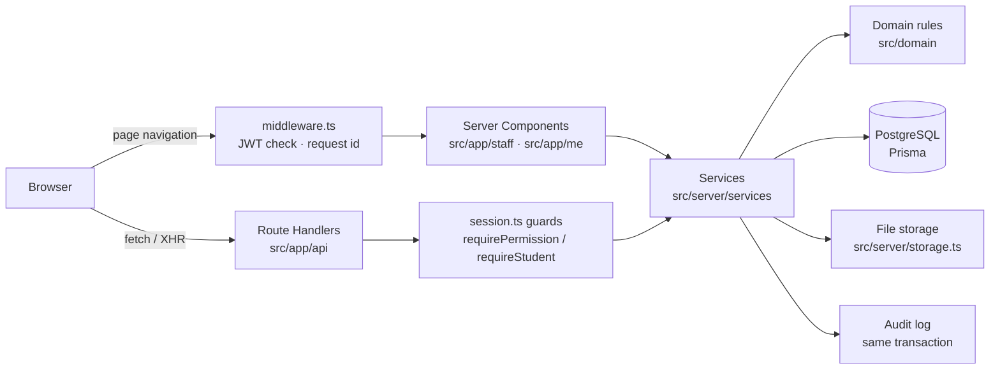
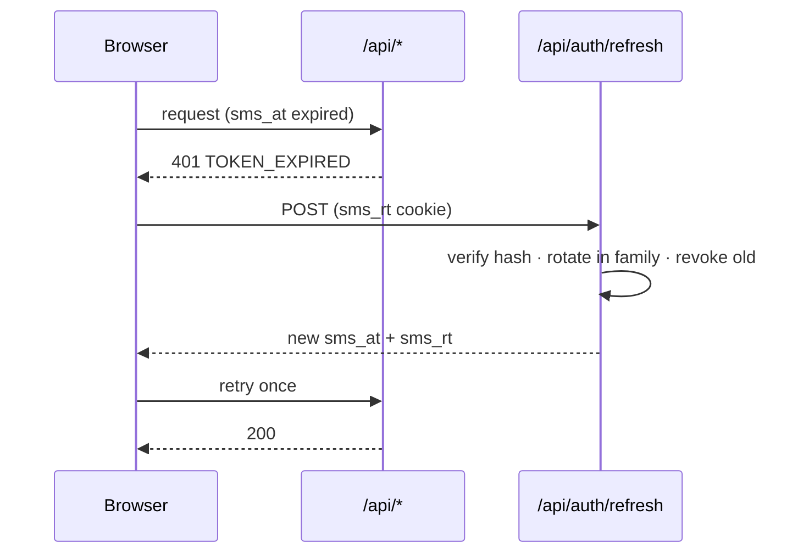
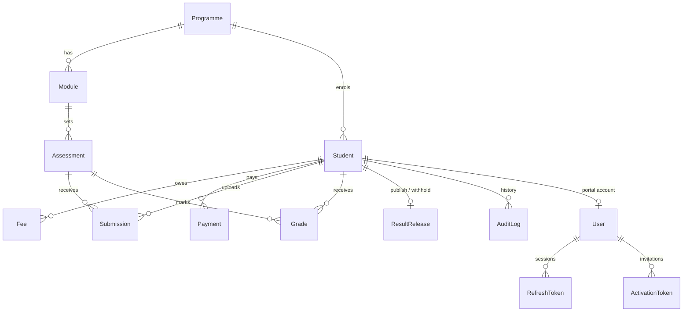

# Architecture

How the Registry module is put together: layers, request flow, authentication, authorisation, data model, UI system, error handling and testing.

For *what* the system does, see [FEATURES.md](./FEATURES.md); for each role's features mapped to the code, see [ROLES.md](./ROLES.md). The product rules and the reasons behind them are in the [README](../README.md#product-decisions--edge-cases).

---

## 1. Overview

A single Next.js 15 (App Router) application backed by PostgreSQL through Prisma. No separate backend: Server Components and Route Handlers are the server.



| Layer | Folder | Responsibility | Depends on |
|---|---|---|---|
| Domain | `src/domain` | Pure business rules: money, fees (FIFO overdue), grades, submission rules, student IDs, file types, **permission matrix** | nothing |
| Shared lib | `src/lib` | Code shared with the browser: zod schemas, formatting, API client, page-access rules, UI logic (nav, breadcrumbs, table URL state, form-error mapping…) | domain |
| Server | `src/server` | Services (use-cases), auth, guards, HTTP wrapper, errors, logger, audit, storage, config | domain, lib, Prisma |
| App | `src/app` | Pages (`staff/`, `me/`, `(auth)/`) and API routes (`api/`) | server, lib, components |
| Components | `src/components` | shadcn/ui primitives (`ui/`), app shell, data table, form kit, shared page blocks | lib |

**Rules that keep it clean**
- Business rules are pure functions in `src/domain`, so they're trivially testable and shared between the server and the UI. The live classification preview uses the same `classify()` as the API.
- **Reads:** Server Components call services directly.
- **Writes:** always go through the JSON API, so every mutation is validated, authorised, audited and logged the same way.
- **Defence in depth:** zod at the edge, rules in services, unique and CHECK constraints in Postgres.

---

## 2. Folder map

```
src/
  app/
    (auth)/            login, activate (no app shell)
    staff/             dashboard, students, students/[id], assessments, assessments/[id], results, account
    me/                student portal: home, assessments (coursework), fees, results, account
    api/               JSON API (see README → API)
    layout.tsx         fonts + providers only (theme, tooltips, toasts)
    error.tsx · global-error.tsx · not-found.tsx
  components/
    ui/                shadcn/ui primitives (generated)
    shell/             sidebar, top bar, breadcrumbs, user menu, theme toggle
    data-table/        URL-synced table, sortable headers, filters, pagination
    form/              useApiForm hook + field components
    account/           change password, sessions
    common.tsx         PageHeader, StatCard, Notice, EmptyState, ToneBadge, DescriptionList
    badges.tsx         status / fees / submission / classification / release badges
  domain/              pure rules (no I/O)
  lib/                 browser-safe shared code
  server/
    services/          students, fees, accounts, assessments, submissions, results, dashboard, auth
    auth/              password (scrypt), tokens, cookies, rate limiter
    session.ts         request guards
    http.ts            route() wrapper: request id, access log, error → HTTP mapping
    errors.ts          typed AppErrors
    logger.ts          structured JSON logger with per-request context
    audit.ts           audit entries, written in the same transaction as the change
    storage.ts         local file storage (swappable)
    config.ts          validated environment
  middleware.ts        page-level auth redirects, silent refresh, request id
prisma/                schema, migrations (incl. CHECK constraints), seed
tests/
  unit/                mirrors src/ (domain, lib, server, components, UI guard)
  integration/         services and real route handlers against a real Postgres DB
  e2e/                 HTTP smoke against a running server
  browser/             Playwright smoke in Chromium
```

---

## 3. Request lifecycle

### Page navigation (e.g. `GET /staff/students`)
1. **`middleware.ts`** runs on the edge. It verifies the access-token JWT (`src/lib/auth/jwt.ts`, `jose`) and asks `pageAccess()` (`src/lib/access.ts`) where this user may go:
   - Signed out, but holding a refresh cookie → `/api/auth/refresh?next=…`, a silent refresh with no visible login.
   - Signed out → `/login?next=…`.
   - Wrong area (a student on `/staff`) → their own home.
2. The **area layout** (`staff/layout.tsx`, `me/layout.tsx`) re-checks on the server. Middleware is a convenience; the layout is the real check. It then renders the **app shell**.
3. The **page** calls `requirePagePermission("students.read")`, then the service. Each section's data is only *loaded* for roles allowed to see it, not merely hidden. For example, finance figures are never sent to an Academic browser.

### API call (e.g. `POST /api/students/:id/payments`)
1. **`route()`** (`src/server/http.ts`) assigns a request id and opens a logging context. It times the request and maps any thrown error to the standard error body.
2. **Guard:** `requirePermission(req, "payments.write")` (`src/server/session.ts`) verifies the JWT, loads the user, and checks it is still active, then checks the permission matrix. The guard returns 401 if there is no valid session (or `TOKEN_EXPIRED` when it has expired) and 403 if the role lacks the permission.
3. **Validation:** `parseJson(req, recordPaymentSchema)`, the *same* zod schema the form uses in the browser.
4. **Service** (`fees.recordPayment`) applies the business rules inside a Prisma transaction and writes an **audit entry in the same transaction**.
5. The response is JSON, or the error body `{ error: { code, message, fields?, requestId } }`.

### Browser side
- **`apiFetch`** (`src/lib/api-client.ts`) sends JSON and turns error bodies into `ApiClientError`. On `401 TOKEN_EXPIRED` it refreshes once (one shared refresh for concurrent calls) and retries. If the refresh fails, it sends the user to `/login?next=<current page>`.
- **`uploadWithProgress`** (`src/lib/upload.ts`) is the same contract over `XMLHttpRequest`, so file uploads can show progress.
- **`useApiForm`** (`src/components/form/use-api-form.ts`) runs react-hook-form with the shared zod schema for instant checks. It submits the **typed values** and the server parses them again. Server field errors land on their inputs; anything else becomes a toast with `Reference: <requestId>`.

---

## 4. Authentication

Hand-written so every step can be explained. There is no auth library hiding the mechanism.

| Piece | Implementation |
|---|---|
| Passwords | scrypt (`N=16384, r=8, p=1`, 16-byte salt, 64-byte key) via `node:crypto`, constant-time compare (`src/server/auth/password.ts`). Policy: ≥ 10 characters and not your email. |
| Access token | JWT HS256, **15 minutes**, `iss: sms-registry`, `aud: sms-web`, claims `sub, role, sid, studentId?, demo?` (`src/lib/auth/jwt.ts`, edge-safe). Cookie `sms_at`: httpOnly, SameSite=Lax, Secure in production. |
| Refresh token | 32 random bytes, **7 days**, only its SHA-256 is stored. Cookie `sms_rt`: httpOnly, SameSite=Strict, `Path=/api/auth`. |
| Rotation | Every refresh issues a new refresh token in the same *family* and revokes the old one. |
| Reuse detection | Presenting a revoked token more than 10 s after rotation is treated as theft: the whole family is revoked. Within 10 s it counts as a benign race between two tabs. |
| Lockout | 5 failed attempts → locked for 15 minutes (demo accounts exempt). The login route is also IP-rate-limited (20 attempts per 15 minutes). |
| Login errors | Always "Email or password is incorrect". A dummy hash is verified for unknown emails, so timing doesn't reveal which accounts exist. |
| CSRF | SameSite cookies plus an Origin check on state-changing requests. |
| Activation | Enrolling a student creates a user with no password and a single-use, hashed, 72-hour activation link. Staff copy the link (no email system). |
| Sessions | Users can list their sign-ins and sign out the others. Changing a password signs out every other session. |
| Demo accounts | `isDemo` users can't be locked, can't change their password, can't sign other sessions out, and only ever see their own session (so reviewers can't see each other's IPs). Enforced on the server. |



---

## 5. Authorisation

One permission matrix in `src/domain/permissions.ts` drives API guards, page guards, navigation, dashboard sections and student-record tabs:

| Permission | Registry Admin | Finance | Academic | Student |
|---|:-:|:-:|:-:|:-:|
| dashboard.read, students.read | ✅ | ✅ | ✅ | |
| students.write, users.manage, audit.read | ✅ | | | |
| finance.read, fees.write, payments.write, payments.void, reminders.send | ✅ | ✅ | | |
| assessments.write, submissions.read, grades.write, results.read | ✅ | | ✅ | |
| results.release | ✅ | | | |

- **Why the split:** academics mark work, but releasing results is a Registry decision (often after fee or misconduct checks). Finance handles money but never touches grades.
- **Students hold no staff permissions.** Their data is reached only through the student-scoped `/api/me/*` routes and `requireStudent`.
- **UI from the same rules:** `navFor(role)` (sidebar), `dashboardSectionsFor(role)` and `studentTabsFor(role)` are derived from the matrix, so the interface can't drift from what the API allows. Visibility is still only a convenience: every route checks again.
- **Matrix test:** `tests/integration/permissions-matrix.test.ts` calls every route as every role.

---

## 6. Data model



- **Money:** `Decimal(10,2)` in the database and **integer pence** in the domain. There is no floating-point arithmetic.
- **Balances** are never stored; they're computed from charges minus non-voided payments, so they're always current.
- **Unique constraints:** `Student.studentNumber`, `Student.email`, `User.email`, `Payment.reference`, `Submission(assessmentId, studentId)`, `Grade(assessmentId, studentId)`.
- **CHECK constraints:** positive amounts, mark 0–100, academic-year and Student-ID formats, lower-case emails, a voided payment must have a reason.
- **Append-only history:** payments are voided, never deleted, and every change writes an `AuditLog` row in the same transaction.

---

## 7. UI system

| Concern | Choice |
|---|---|
| Components | **shadcn/ui** (Radix primitives) in `src/components/ui`, Tailwind CSS 4, `lucide-react` icons |
| Look | Neutral base, one accent (deep indigo). Status colours are used only for meaning: red = overdue/late/fail, amber = attention, green = done. Tabular numerals for money and marks. |
| Theme | `next-themes`: Light / Dark / System, class-based, no flash on load |
| Shell | Collapsible sidebar grouped by area (Sheet on mobile), breadcrumbs, theme toggle, user menu |
| Tables | `@tanstack/react-table` with **server-side** paging and sorting. Filters, sort and page live in the URL (`src/lib/table-state.ts`), so links are shareable. Column visibility is remembered per browser. |
| Forms | `react-hook-form` + the shared zod schemas, server field errors mapped to inputs, toasts (`sonner`) with the request reference |
| Feedback | Pending states on every action, empty states on every list, skeletons while loading |
| Print | Results can be printed. The app shell is hidden in print styles. |

---

## 8. Error handling & logging

- **One error body:** `{ error: { code, message, fields?, requestId } }`. Zod → 400 with per-field messages, Prisma unique → 409 on the right field, not found → 404, rule broken → 422, DB down → 503, rate limited → 429, anything unexpected → 500 with a generic message. Stack traces only go to the log.
- **Request ids:** every request gets an `x-request-id`. It's on every log line, in the response header and in error bodies, and the UI shows it as `Reference: …` so a user's report maps to one log entry.
- **Structured logging:** JSON logs with per-request context (AsyncLocalStorage), optionally appended to `LOG_FILE`. Render errors are captured by `src/instrumentation.ts`.
- **Boundaries:**
  - `error.tsx`, `global-error.tsx` and `not-found.tsx`; unknown records return a real **404 status**.
  - `GET /api/health` reports DB connectivity.
  - If the database is down, the shell shows an outage notice instead of signing the user out.

---

## 9. Testing strategy

| Suite | Runs against | What it proves |
|---|---|---|
| Unit (`tests/unit`) | Pure functions, hooks in jsdom | Domain rules at every boundary, schemas, JWT/password/token primitives, UI logic (nav, breadcrumbs, table state, tabs, countdowns, statements, uploads, form-error mapping), and a guard that no v1 styling remains |
| Integration (`tests/integration`) | Real route handlers + real Postgres (`TEST_DATABASE_URL`) | Auth flows (rotation, reuse detection, lockout, activation), the permission matrix over every route, concurrency (ID generation, void races), file storage, withheld results never leaking |
| E2E (`tests/e2e`) | A running server over HTTP | Real sign-in per role, redirects, every page rendering, seeded edge cases, real 404s |
| Browser (`tests/browser`) | Playwright in Chromium on a production build + the seeded test DB | One-click sign-in per role, every page with zero console errors, tabs, mobile sidebar, dark mode, role redirects, and the flows that write data (enrol, pay, create + mark, upload, publish → student sees marks) |

Everything is written test-first. CI (`.github/workflows/ci.yml`) runs lint, typecheck, unit and integration tests against a Postgres service, and a production build on every push and pull request.

---

## 10. Deployment notes

- Any Node host with a **persistent disk** for `UPLOAD_DIR`, plus a managed Postgres (`sslmode=require`).
- `prisma migrate deploy` on release.
- Required: `DATABASE_URL`, `JWT_SECRET` (≥ 32 characters). Set `DEMO_MODE=false` outside a demo.
- Serverless hosts without a disk need the storage adapter (`src/server/storage.ts`) swapped for object storage.
